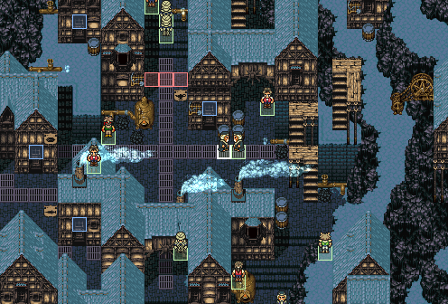

# FF6Tools for SNES Advance

**Editor v0.7 for SNES Advance Regular v1.6.5**

An offline ROM editor for the SNES Advance backport of Final Fantasy VI. Paint maps, place NPCs and chests, edit their events and dialogue, or work with the expanded monster, item, spell and Esper tables.



## Start editing

Extract the whole ZIP, open **index.html**, and choose **Open ROM**. You can open Final Fantasy III (USA) v1.0 or v1.1 directly, or keep working on an existing SNES Advance Regular ROM. **Export ROM** saves a separate file. Conversion and editing run locally in the browser.

The Windows offline checks passed in Chrome 157 and Firefox 160. [Release notes](RELEASE_NOTES.md) · [Validation](VALIDATION.md) · [License](COPYING) · [Credits](NOTICE.md)

## Edit a map in one place

Open **Map editor** at the top of the table list. The opening example is **$014 Narshe: South Exterior (WoB)**. The selected resident at **(42, 25)** talks through **$CC/D1FF**. The command below the map opens dialogue **$0397**, “So…magic really DOES exist!?” Edit its text in place, or select a different resident to inspect their event. Search the map list for **Dragon’s Den**, **Soul Shrine**, a decimal ID or a hexadecimal ID.

| To do this | In the map editor |
|---|---|
| Paint terrain | Select **Paint tiles** and a layer. Click a tile in the tileset, or drag a rectangle to pick a stamp. Drag on the map to paint. Right-click or Shift-click picks a tile from the map. One stroke takes one Undo. **Isolate paint layer** shows just the working layer. A notice identifies shared layouts. |
| Inspect or move an object | Choose **Select / move** and click a marker or an ordinary NPC sprite. Drag to move it, or edit its X and Y in the inspector. Repeated clicks cycle through overlapping objects. The **Map object** list also selects and centers entries. |
| Place a chest or an exit | Choose the corresponding **Place** tool and click the destination square on the canvas. The inspector opens immediately. For an item chest, choose the item by name. An exit has a destination map, arrival coordinates and facing. Long exits also have a span and orientation. **Open destination** follows the exit. |
| Place a talking NPC or floor trigger | Click to place it, then edit its command list below the map. Insert a dialogue, item, GP, event bit or call. Reorder commands or edit the source under **Event source**. **Apply event to this object** binds the result. To run a cutscene on arrival, choose **Entrance event**. |
| Find a line behind a native branch | Select its call and choose **Inspect original routine**. For a conditional, choose **Branch taken** or **Fall through**. A display-dialogue instruction opens its linked text. The original routine stays at its native address. |
| Use the keyboard or exact coordinates | Select a map object from the list, or enter X and Y and choose **Use tool here**. **Center** scrolls to a coordinate. Arrow keys in the tile palette change the brush. |

The canvas uses static map graphics from the open ROM. Ordinary NPCs appear in their stored poses. Vehicles and special sprites have selectable markers. A map may contain several story-dependent NPCs on the same square. The editor shows the stored placements together. World maps support terrain, tile triggers and single-tile exits.

Dialogue text belongs to the selected dialogue ID. Changing its words affects every event that displays that ID. To give just one character a different line, change its **Display dialogue** command to another dialogue ID. Text edits preserve controls and the slot’s encoded-byte limit. An object can share an authored scene through **Use selected scene**. Applying a command edit to just one object gives that object its own copy when others share the scene. Original object slots keep their indices. Added objects can be removed from the inspector.

## Build a room and play it

1. Open **Rooms and objects**, select **$19F Dragon’s Den entrance**, name the new room, and click **Create independent room**. On a fresh project the annex receives map **$1AF**. It inherits the template’s dimensions, appearance and music. It starts with independent tile layers, empty object lists and random battles disabled.
2. Use **Paint room** to change the floor. The room properties let you choose music, palette, layer 1 and 2 tilesets and the collision set. The two buttons beside the painter open the current tileset composition and collision editors.
3. On **$19F**, add a **single-tile exit** at **(9, 9)**. Enter destination map **431** and destination coordinates **(10, 9)**. On **$1AF**, add a return exit at **(9, 9)** with destination map **415** and destination coordinates **(10, 9)**. The numeric object fields take decimal values.
4. Choose **Edit entrance cutscene** on the annex. Give the scene a name. For an NPC using visibility switch 0, enter the two lines below and click **Save and bind scene**. This switch is shared game state. In a real quest, choose a visibility switch appropriate for the story.

```text
set_bit $300
return
```

5. Create another field scene, for example `dialogue $0001` followed by `return`, and click **Save scene**. In **Rooms and objects**, add an NPC at **(11, 9)**, select this scene under **Run scene**, and click **Add object**. Use an existing field dialogue ID for the words you want the NPC to say.
6. Export the ROM and enter the Dragon’s Den. Walk onto the new exit, talk to the NPC and take the exit back. Reopening the exported ROM restores the room name, editable source and bindings.

## Authoring tools

| Editor | What you can edit |
|---|---|
| Rooms and objects | Clone a field map into a new map ID, paint its independent layers, add NPCs, treasures, floor triggers and single- or multi-tile exits. World maps accept floor triggers and single-tile exits. An added chest defaults to an unused opened-chest flag. |
| Field cutscenes | Write a scene for an entrance, tile trigger or ordinary NPC. **Run when** also lists the existing triggers and ordinary NPCs on that map. **Read original event** decodes its linear opening and leaves a call to the existing code when it reaches a branch or an uncertain continuation. The command reference includes named operations, byte operands and labels. |
| Battle events | Edit all 33 event command lists, including introductions, the Blitz tutorial and the final battle. Events can invoke the game’s existing character and monster animation scripts. Monster AI remains available in its own editor. |
| Tile collision and World tile properties | Edit 42 shared field sets of 256 tiles. Change directional passage, elevation, ladder, door and NPC flags. The Balance and Ruin world tables contain 256 tiles each, with flags for travel, airship landing and random encounters. |
| Tileset composition | Edit the four 8 × 8 quadrants of a field metatile, including its graphics tile, palette, priority and flips. The 75 layer 1 and 2 tilesets are shared across maps. |
| Import graphics | Import a whole PNG or copy a rectangle to a chosen destination on the sheet. Preview the result and optionally generate SNES colors. Supports ordinary monster battle sprites, field sprite sheets, field tileset graphics including layer 3, and the three world maps. Game-palette mode uses the selected colors. **Index grayscale** gives every palette index a distinct shade. Transparent pixels select index zero. |
| Battle animations, Animation resources and Animation frames | Change 406 effect configurations, their sounds, palettes and delays. Select from 674 graphics resources and edit their frame sequence and dimensions. The frame editor shows tile placement and supports moving, flipping and replacing existing slots across 3,025 frames, including 77 added frames. |

### Storage and editing limits

- Regular has room IDs **$1AF–$1FD** available in this editor. The number of rooms that fit depends on their compressed layers and project size. The editor reserves 56 KiB for added tiles, 16 KiB for field event programs and 96 KiB for project metadata including the header. A capacity failure leaves the previous edit intact.
- An NPC record has an 18-bit talk-event address. Three distinct authored NPC scenes can use the forwarders into expanded ROM. Multiple NPCs can share a scene. Entrances and tile triggers use full addresses. The field engine supports 32 NPC records on one map. Added chests retain the game’s existing reward encodings.
- PNG imports use the existing graphics geometry and palette depth. Some monsters share artwork and some special sprites, such as the Phantom Train background, use a different renderer. Frame edits retain each frame’s allocated tile count. Handwritten 65816 routines and the low-level character animation thread interpreter are outside the source editor.
- A room, field event, battle event, layer 3 import or field collision edit activates the authoring directories. These consume verified space within the existing 4 MiB ROM. The original map directories remain available as the project’s baseline. The editor checks the live compiled tables against the embedded source on reopen.
- **Apply** or **Save** commits an edit to the current session. **Export ROM** writes it to disk. Field event, battle event and animation-frame drafts stay available while you browse. Export takes you back to an unapplied draft.

## Import a sprite pose or a tileset detail

In **Import graphics**, select the graphic and its palette, then choose **Import PNG**. Drag over the source image to select the detail and click the destination sheet to place it. For exact placement, enter source X/Y, width/height and destination X/Y in pixels. Source and destination can have different dimensions. The selected rectangle is copied at its original scale.

| PNG colors | When to use it |
|---|---|
| Exact game colors | Bring back art exported with the game palette. An unfamiliar opaque color is flagged in the preview. |
| Nearest game colors | Import RGB artwork while keeping the game’s current palette. Each incoming color maps to an available ink. |
| Generate shared palette | Build SNES colors from the selected pixels. The importer preserves ink zero and inks used elsewhere on this sheet. If all available inks are in use, new colors map to the closest available ones. |
| Index grayscale | Use exact ink numbers, including colors that look identical. Export in this mode to see the shades for the current bit depth. |

The preview shows palette changes, the number of changed pixel indices and how many pixels needed a different SNES color after conversion to the console’s 15-bit color space. Two-, three- and four-bit sheets have 3, 7 and 15 opaque inks respectively. Transparent source pixels clear the corresponding destination pixels. Use fully opaque or fully transparent pixels and keep visible pixels inside the sprite’s allocated mask.

Changes to shared artwork appear in every pose or monster using it. Changing a shared palette entry can recolor other sprites or maps that use that entry. Check the before/after swatches, then choose **Apply import**. One **Undo** reverses both the pixels and the palette. An uncommitted preview stays available when browsing; **Export ROM** returns to it so you can apply or discard it.

## Edit a monster script

Choose **Monster scripts**, then select a monster by name or ID. The upper part of its script runs on its turns. The part after the first `end` handles counters. The editor shows attack names in comments and lists the available commands beneath the editing box. You can insert, remove or change commands. Select **Apply script**, then **Export ROM**. Undo and redo work across script, map and stat edits. The editor keeps an unapplied script draft when you switch records and brings you back to it before exporting.

For a simple experiment, select **$104 TunnelArmr**, place the cursor above a command in the main script, and use **Insert attack** to add a move from the picker. The two `end` instructions must remain. A longer script can move into reserved space. An edit to an overlapping script gets a separate copy so the other monster retains its original behavior. The assembler checks the instruction format. Test the behavior of a new script in battle.

## Paint a map

1. Choose **Map tiles**. The starting selection is **$19F Dragon’s Den entrance**. **$0E5** and **$0E6** open the Soul Shrine maps. IDs **$000–$002** open the World of Balance, World of Ruin and Serpent Trench.
2. Choose a layer. Click a tile in the tileset or drag across a rectangle to make a multi-tile stamp. Click or drag on the map to paint. Shift-click or right-click picks a tile from the map. You can also focus the tileset, choose a tile with the arrow keys, enter X and Y, and click **Paint at coordinates**.
3. One stroke takes one undo. A shared-layout notice names every map that uses the layer. **Export ROM** saves the edits. Reopening that export lets you continue painting.

The painter shows one layer at a time, using graphics and colors from your ROM and the first frame of animated tiles. It keeps the existing dimensions and edits the stored portion of the selected layer. The game controls collision, scrolling, animation, color math and layer composition separately. Replacing a tile uses the behavior the game assigns to that tile ID.

## Additional editors

| Editor | What you can change |
|---|---|
| Field palettes | 49 palettes of 128 SNES colors. Choose a swatch to update a color. The tile painter uses the edited palette. |
| Map NPCs, chests, exits and triggers | Existing slots for 2,287 NPCs, 312 chests, 1,129 single-tile exits, 204 multi-tile exits and 1,367 event triggers. Find records by map name or hex map ID. Edit NPC position and selected properties, chest reward and flag, exit position and destination, or move the tile that starts an existing event. Scripted scenes can supply their own rewards or NPC movement. |
| Field dialogue | Search for words or a dialogue ID in the original field bank or either added bank. Each text box edits the words between two game controls. The budget counts encoded bytes. The editor can shorten a line or use spare bytes in its slot. Check longer wording on screen for line width. Of 3,260 IDs, 3,252 have independently editable text. Shared or overlapping slots are protected. |
| Characters and shops | Starting stats, equipment, commands, shop type, price modifiers and the eight merchandise slots. The item selectors use the IDs supported by these byte-sized fields. |
| Battle skill tables | Rage and Dance actions, Control and Sketch actions, Terra and Celes’s natural magic and the levels for Blitz and SwdTech learning. |

## FF6Tools coverage

This edition targets Final Fantasy III USA converted to SNES Advance Regular v1.6.5. It uses upstream FF6Tools’ ROM model, undo system and SNES graphics codecs. The authoring table above describes the supported workflows. The retail conversion table below describes which pre-existing retail edits the importer can carry into Regular.

## Bring a retail project into Regular

Select your working retail ROM, including your edits. This takes one file. The editor builds Regular and opens its expanded tables immediately. A clean cartridge dump from either revision produces the official v1.6.5 Regular ROM (4 MiB, CRC32 `5ACCB7C3`). A modified import reports that it carried content edits forward. For example, an enemy whose HP you edited in retail appears with that HP in the Regular editor and in battle.

| Existing retail edits | What carries over |
|---|---|
| Monsters | 381 original stat and loot records. 379 ordinary names. The three slots Regular uses for Gilgamesh, Gigantuar and Leviathan are protected, along with two special-format names. |
| Encounters | All 576 original six-slot formation records. Active slots must refer to monster identities retained by Regular. |
| Gear and items | All 255 usable retail item records, including names, icons, prices and equipment properties. |
| Magic | All 54 player spell and 27 original summon attack records. All 27 original Esper teaching and bonus records. Ordinary teaching slots accept the original spell IDs or empty. |
| Maps | Music and the random-battle flag on 411 original map records. Four changed or repurposed records are protected. |
| Field dialogue | In-place character, symbol and two-character compression substitutions at 117,264 encoded byte positions across the original text banks. Pointers, control codes, their operands and string endings are protected. Check the text box in game after editing its wording or width. |
| Cartridge metadata | Internal title and optional 512-byte copier header. A 3 MiB image padded to 4 MiB with entirely `00` or entirely `FF` is also accepted. The output receives the Regular checksum. |

The importer clears just the approved positions in a temporary copy and checks the entire remaining image against a known US revision with SHA-256. It applies a checked delta, verifies the resulting Regular template and copies approved values to the active tables and required mirrors. It then runs the same checks used when opening an existing Regular project.

An edited engine routine, moved text bank, changed event or AI script, or occupied expansion can require its own adapter. When a 3 MiB input fails verification, the message identifies the first differing 256-byte pages of the closest revision, in **headerless file offsets**. Import is all-or-nothing. You can continue working in any previously open ROM. Existing Regular projects continue to use the Regular layout checks described below.

## Make a Dragon’s Den encounter

1. In **Item properties**, find **$101 Final Trump**. Rename it **Den Saber**, set attack power to **147**, and check **Terra** under **Can equip**.
2. Find **$10E Bone Wrist**, rename it **Den Wrist**, enable Terra, and set defense and magic defense to **50** and **60**.
3. In **Monster stats**, rename **$1C0 Zurvan** to **Den Sentry** and set HP to **12345**. In **Formations**, select **$244** (580 decimal), set slot 1’s X position to **80**, and check the preview.
4. Export and reopen the copy. In game, a save with the gear allows Terra to choose Den Saber in Equip and Den Wrist in Relic. Existing descriptions are separate strings. For example, Bone Wrist’s stock description still mentions Umaro.

The emulator check in **VALIDATION.md** walks through both actual equipment menus and a fight with this encounter. The items must already have been obtained through the game or a suitable practice save.

## Supported fields

| Table | Coverage | Edits |
|---|---|---|
| Monster stats and names | 420 selectable slots across 452 allocated records | Fixed-width names, HP, MP, level, speed, attack, hit rate, evade, magic block, defense, magic defense, magic power, EXP and GP. Two special-format names are protected. |
| Monster loot | 420 slots | Common and rare steals and drops. Each accepts an original byte-sized item ID or $FF for nothing. |
| Formations | 645 records, six slots | Monster, presence, X and Y. Selecting $1FF clears the active flag. The normal-orientation sprite preview uses the input ROM’s art, masks, palettes and current slot positions. It flags oversized sprites and unallocated slots. Phantom Train uses special background graphics. The preview omits battle backgrounds, actors, event-driven replacements and animation. |
| Items | 270 usable identities, including $100–$10E | Fixed-width name, price, power or defense, hit rate or magic defense as applicable, and the 14 character eligibility bits on equippable types. The item icon and the two other equipment flags are preserved. Eligibility changes affect the item’s mask. Individual characters and contexts may have separate game rules. |
| Esper learning | 31 records | Ordinary teaching slots and level-up bonuses. Leviathan’s teaching slots and the dedicated Gravija/Valor pairs are read-only. Editable slots offer the original 54 learnable spells and empty. The battle engine handles progress for the three added spells separately. |
| Player magic and summon attacks | 57 player spells, 27 original summon records and seven added summon attack records | MP cost, power and hit rate. Gilgamesh has four attack records. Player magic and ordinary attacks can share an ID and use different properties. |
| Map properties | 431 records | Music and random-battle flag. Inspect the three layer IDs. Open Map tiles to paint them. Events may override the map’s ordinary behavior. |

ID search accepts decimal and hexadecimal. Names allow up to 12 game characters for items and 10 for monsters. Unsupported glyphs and overlength names produce an error before any bytes change. Existing ordinary and padding-style spaces are preserved when possible. Search, selectors and formation labels follow name edits and undo/redo.

## Working alongside another editor

The loader checks the SNES mapping, the known instructions that read these tables, relevant dispatch code and matching original/expanded records. A title, text, graphic, event or unrelated code change can coexist when these structures remain compatible. A conflicting reader or mirror produces a message identifying the table and SNES address. Changing only one required copy in another editor can produce a legitimate conflict. To make that edit, start from the last consistent copy and apply it through this editor, or synchronize the two copies in your authoring project.

The exporter starts from the file you opened, changes the requested fields and their mirrors, and updates the header checksum after an edit. For added equipment, it also updates the character mask embedded in the field menu. An untouched export of an already-Regular input matches it byte for byte. The editor preserves the copier header on export. The layout checks cover known readers. An arbitrary engine rewrite could reroute execution elsewhere. Translation editions and option combinations need separate validation. The variable-size script and map writers use separate reserved ranges. An occupied range prevents an edit that would require relocation.

## Tests and source

- **VALIDATION.md** records the v0.7 Windows browser results, emulator checks and byte comparisons. The original Chrome and Firefox reports are in **tests/reports/v0.7/**.
- **tests/model_test.cjs**, **tests/features.cjs** and **tests/ui_unit_test.cjs** each take the clean Regular ROM path as their argument. Run them with Node.
- **tests/retail.cjs** takes three headerless inputs in order: USA v1.0, USA v1.1, and the official Regular output. It checks whole-file results for stock, edited and padded ROMs on both revisions.
- **tools/build-retail-import.py** regenerates **retail-data.js** from the official v1.6.5 release ZIP and clean local USA v1.0 and v1.1 dumps. It needs only Python's standard library. The packaged editor already includes the generated import data.
- **Windows-browser-check.html** runs the native browser check with the browsers already installed. Open that file in **Edge or Chrome** and then **Firefox**. In each browser, choose a clean USA retail ROM. After the scripted checks pass, you can make additional edits. Click **Export ROM**, then **Reload for reopen check** and select your most recent downloaded `.smc`. The browser compares the entire file with the exact copy you exported. A browser-added number or a different filename is fine. **Save test report** writes a small JSON file containing the browser, platform, checks and output hash. The archived v0.3 reports are in **tests/reports/v0.3/**. No Python or internet connection is required.
- **tests/browser_test.py** automates file selection, editing, real downloads, closing and reopening, the interactive check, and conflict handling. Give it a clean US retail ROM, a fresh temporary output directory, and the target (`chromium`, `chrome`, `msedge`, or `firefox`). It also accepts clean Regular for the editor-only suite. On Windows with Python and Playwright installed, run `python -m playwright install firefox` once, then `.\tests\windows-matrix.ps1 -Rom "C:\Games\FF3.sfc"` in PowerShell. This path tests installed Edge and Playwright's Firefox build. Use `-Browsers chrome,firefox` for Chrome. Reports record which browser and source each run used.
- **tests/graphic-import.cjs** checks crops, palette fitting, protected colors, atomic undo/redo and export/reopen across all supported graphics types. An optional output path writes a TunnelArmr recolor for an emulator check.
- **tests/authoring.cjs** exercises rooms, event scripts, graphics, collision and animation resources. An optional output path writes a playable test fixture. Add **--png** to round-trip real PNG files using Python and Pillow.
- **tools/build-author-layout.py** regenerates the authoring metadata from Regular, upstream’s **ff3u-sfc.json**, and **src/btlgfx/battle_event_script.inc** from the FFVI disassembly.
- **tests/workshop.cjs** takes a clean Regular ROM. It checks scripts, map compression, world maps, fixed tables, dialogue and undo. An optional second path receives a test ROM and a JSON file describing an edited battle script and Dragon’s Den tile for emulator checks.
- **tools/build-regular-profiles.py** regenerates the added profiles from a clean Regular ROM and upstream’s **ff6/ff3u-sfc.json**. The pinned upstream revision is in the script. The packaged editor already includes these profiles.
- **tools/inspect-definition.cjs** generates a read-only native FF6Tools JSON definition, including the animation tables and NPC facing and movement fields. Run `node tools/inspect-definition.cjs Regular.sfc definition.json`. Choose a new output filename.
- **profile.js** describes the Regular layout and reads. **engine.js** handles import, names, validation, native FF6Tools actions and export. **formation-preview.js** decodes the sprite artwork. **ui.js** drives the browser interface.

FF6Tools is by everything8215 and contributors. This independent edition ships its runnable source under GPLv3. See **NOTICE.md**, **COPYING** and the upstream README under **vendor/**.
